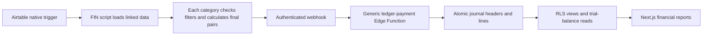

# Implementation detail

## End-to-end flow

The T-Chart guides the Airtable implementation. The receiver does not interpret a T-Chart category
to decide how to debit or credit an account. It receives complete posting pairs and records them.

## Source map

| Path | Responsibility |
| --- | --- |
| `airtable/` | Six native sender sources used by seven ledger automations; focused mock checks |
| `supabase/functions/ledger-payment/` | Shared-secret HTTP boundary and generic transactional writer |
| `supabase/migrations/` | Tracked database changes, including lifecycle metadata and nullable branch |
| `lib/reports/ledger.ts` | Authenticated report queries and General Ledger pagination |
| `lib/reports/report-session.ts` | One shared Auth check per request; ledger reads run as the signed-in user |
| `lib/reports/t-chart.ts` | Posting-rule grouping, filtering and account-reference parsing |
| `lib/reports/statement-loaders.ts` | Server reads for one statement data window (IS year/months, BS as-of date) |
| `lib/reports/statement-data.ts` | Builds every IS/BS View and Display from one data window; runs in the browser |
| `components/StatementWorkspace.tsx` | IS/BS client state for View/Display switches without a request |
| `lib/reports/income-statement.ts` | Income Statement grouping, periods and totals |
| `lib/reports/balance-sheet.ts` | Cumulative balance snapshots and per-year earnings baselines |
| `lib/reports/analytics.ts` | Position/Movement data derived from the report and comparison periods |
| `components/ReportView.tsx` | Shared report table, account display filters, collapse controls and exports |
| `components/ReportAnalytics.tsx` | Accessible Position/Movement tabs and compact signed-value charts |
| `components/LedgerTable.tsx` | Trial Balance and paginated General Ledger tables, account-to-ledger links |
| `components/AccountDrawer.tsx`, `components/account-drawer.css` | Slide-over account drill-down: summary, filters and posted lines |
| `lib/reports/account-activity.ts` | Drill-down summaries, natural-sign amounts and line filters (cents) |
| `app/(reports)/account-activity-action.ts` | Server action that loads one account's totals and lines as the signed-in user |
| `components/LedgerAccountFilter.tsx` | General Ledger account and offsetting-account query filters |
| `components/PostingRulesTable.tsx` | T-Chart posting-rule table |
| `components/ReportNavigation.tsx` | Client navigation, GET forms, immediate spinner/skeleton feedback |
| `app/page.tsx`, `components/LoginForm.tsx`, `app/landing.css` | Public landing and existing sign-in flow |
| `middleware.ts`, `lib/supabase/` | Session validation, approved-user gate and user-scoped database clients |

## App entry and access

`/` renders the full-screen architectural landing for signed-out visitors. It uses a generated
text-free background with navy waves/brass artwork and live HTML typography/form controls. The
brand has two rows: `Chicago Brass` and `Financial reporting, in one place.` There is no separate
Finance line or logo. Source Serif 4 and Manrope are self-hosted; OFL licenses are in `app/fonts/`.

Successful email/password sign-in goes to `/income-statement`. Microsoft sign-in remains optional
behind the existing configuration flag. An already authenticated visitor to `/` is redirected to
the reports. `/login` preserves old links by redirecting to `/`, including callback-error context.
Signout and failed callbacks return to the landing. No signup or custom attempt/cooldown system
was added. Password visibility, busy state and recoverable errors are implemented.

Middleware still validates the session and checks `current_app_role` before protected pages. Public
access to the landing does not expose reports. Report clients use the signed-in identity through RLS.

## Report behavior

- Income Statement: posted actuals for selectable years/month ranges; monthly, quarterly or annual
  columns; Summary/Details; whole selected months; no workbook forecasts or fixed historical cutoff.
- Balance Sheet: cumulative snapshots; as-of, monthly, quarterly or annual columns. Annual shows the
  preceding two December 31 balances and the exact selected as-of balance. These columns are not summed.
- Earnings: each Balance Sheet column uses its own previous-year baseline. Unclosed prior-year
  earnings and current-year earnings are separate from existing equity balances.
- Trial Balance: cumulative account debit, credit and natural-balance fields, with full-account totals.
- General Ledger: posted `v_ledger` records, 100 per page plus one lookahead. Stable order is date,
  entry number and line number. Date changes reset page one. Account and offsetting-account filters
  run in the query and survive date and page changes. Search/side controls apply to the current
  page, whose totals are explicitly labeled as page totals.
- T-Chart page: database rule/catalog metadata in one grouped table. It does not execute Airtable
  category filters.

All four financial report pages display USD cents and `$0.00`. Display filters preserve full-report
totals; General Ledger separately labels its loaded-page totals. Dates are formatted as calendar
dates without browser timezone shifts. See [the detailed mappings](../docs/ledger-reporting.md).

## Report UX and loading

The shared shell fills the viewport. Header, filters and controls remain outside the scrolling
table. Table headings/account labels stay fixed where applicable; the dark analytics sidebar has
its own scroll area. Narrow screens stack the panels; print returns tables to document flow.

Headings use one row: title, vertical divider and description. Dates are not repeated in Trial
Balance/General Ledger headings because their filters already show them. Statement columns use
month names, Q1-Q4 or years, with exact partial-snapshot dates retained where needed.

Next client navigation replaces full-page filter reloads. A spinner/skeleton appears during a
transition and stale controls become inert. Visited pages stay in the browser router cache for
five minutes, so revisits are instant; the server does not cache ledger reads. A reload or the top
bar's Refresh data button reads the latest postings. One Auth check per request is shared by the
layout and reads. Income Statement and Balance Sheet View/Display switches are built in the browser
from data loaded once per year/month range or as-of date, so they make no request. Batching those
trial-balance reads into one database call is the planned next step.

Account rows on the Income Statement, Balance Sheet and General Ledger open a slide-over drawer
above the page with that account's summary, filters and posted lines. It loads through a server
action on each open, without a cache, and keeps no URL state. See
[the drawer contract](../docs/ledger-reporting.md#account-drill-down-drawer).

## Local setup

Run `npm run dev -- --port 3010` from the repository. Jeric has used `http://localhost:3010` for the
signed-in browser and the loopback IP host for an independent signed-out check. Browser cookies are
host-scoped; do not clear the user's normal session for visual tests.

The default public Supabase configuration targets DUAL ENTRY. Environment variables can override it,
so verify the actual process environment before diagnosing the database. Do not reuse another app's
local Supabase variables, restart other shared dev servers or print secrets.
