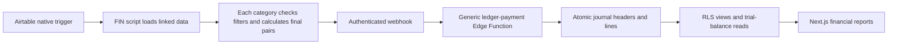

# Implementation detail

## End-to-end flow

The T-Chart guides the Airtable implementation. The receiver does not interpret a T-Chart category
to decide how to debit or credit an account. It receives complete posting pairs and records them.

## Source map

| Path | Responsibility |
| --- | --- |
| `airtable/` | Six native sender sources used by seven ledger automations; focused mock checks |
| `supabase/functions/ledger-payment/` | Shared-secret HTTP boundary and generic transactional writer |
| `supabase/migrations/` | Tracked database changes, including lifecycle metadata and nullable branch |
| `lib/reports/ledger.ts` | Authenticated report queries and General Ledger pagination |
| `lib/reports/report-session.ts` | One shared verified-JWT check per request; middleware retains live Auth/allowlist validation |
| `lib/reports/t-chart.ts` | Posting-rule grouping, filtering and account-reference parsing |
| `lib/reports/statement-loaders.ts` | One batched `get_trial_balances` read plus the posted count per statement data window |
| `lib/reports/statement-data.ts` | Builds every IS/BS View and Display from one data window; runs in the browser |
| `components/StatementWorkspace.tsx` | IS/BS header, controls, query loading/error states, local View/Display and export readiness |
| `components/LedgerWorkspaces.tsx` | Persistent TB/GL/T-Chart controls; optimistic ledger filter scope and independent account options |
| `components/SearchableSelect.tsx` | Searchable single-select with keyboard interaction and dialog-aware popup placement |
| `components/FilterControls.tsx`, `components/filter-controls.css` | Shared filter bar, top label, search field and keyboard-operated segmented switch across reports and drawer |
| `lib/reports/income-statement.ts` | Income Statement grouping, periods and totals |
| `lib/reports/balance-sheet.ts` | Cumulative balance snapshots and per-year earnings baselines |
| `lib/reports/analytics.ts` | Position/Movement data derived from the report and comparison periods |
| `components/ReportView.tsx` | Shared data panels plus controlled account display/collapse/export helpers; no inner toolbar |
| `components/ReportAnalytics.tsx` | Accessible Position/Movement tabs and compact signed-value charts |
| `components/LedgerTable.tsx` | Trial Balance and paginated General Ledger tables, account-to-ledger links |
| `components/AccountDrawer.tsx`, `components/account-drawer.css` | Slide-over account drill-down: summary, filters and posted lines |
| `lib/reports/account-activity.ts` | Drill-down summaries, natural-sign amounts and line filters (cents) |
| `app/api/reports/account-activity/route.ts` | Independent authenticated GET reads for account totals and lines |
| `lib/reports/account-activity-server.ts` | Validates the drill range, batches totals and reads up to four 500-line pages |
| `lib/reports/account-activity-client.ts` | Aborts abandoned requests and caches successful sections within one report snapshot |
| `components/LedgerAccountFilter.tsx` | General Ledger account and offsetting-account query filters |
| `components/PostingRulesTable.tsx` | T-Chart posting-rule table |
| `components/ReportNavigation.tsx` | Immediate URL navigation inside the financial workspace, data refresh and progress |
| `components/ReportApplication.tsx` | URL-driven destination shells; no financial read blocks navigation |
| `components/ReportData.tsx`, `lib/reports/report-data-client.ts` | Private user-scoped five-minute JSON cache, request sharing, refresh and auth invalidation |
| `components/ReportDataPanel.tsx` | Data-only pending/error/retry UI and render boundary |
| `lib/reports/report-routes.ts` | Shared normalized filter options and canonical data request keys |
| `app/api/reports/data/route.ts` | Authenticated JSON reads for each report and Ledger account choices |
| `app/page.tsx`, `components/LoginForm.tsx`, `app/landing.css` | Public landing and existing sign-in flow |
| `middleware.ts`, `lib/supabase/` | Session validation, approved-user gate and user-scoped database clients |

## App entry and access

`/` renders the full-screen architectural landing for signed-out visitors. It uses a generated
text-free background with navy waves/brass artwork and live HTML typography/form controls. The
brand has two rows: `Chicago Brass` and `Financial reporting, in one place.` There is no separate
Finance line or logo. Source Serif 4 and Manrope are self-hosted; OFL licenses are in `app/fonts/`.

Successful email/password sign-in goes to `/income-statement`. Microsoft sign-in remains optional
behind the existing configuration flag. An already authenticated visitor to `/` is redirected to
the reports. `/login` preserves old links by redirecting to `/`, including callback-error context.
Signout and failed callbacks return to the landing. No signup or custom attempt/cooldown system
was added. Password visibility, busy state and recoverable errors are implemented.

Middleware still validates the session and checks `current_app_role` before protected pages. Public
access to the landing does not expose reports. Report clients use the signed-in identity through RLS.

## Report behavior

- Income Statement: posted actuals for selectable years/month ranges; monthly, quarterly or annual
  columns; Summary/Details; whole selected months; no workbook forecasts or fixed historical cutoff.
- Balance Sheet: cumulative snapshots; as-of, monthly, quarterly or annual columns. Annual shows the
  preceding two December 31 balances and the exact selected as-of balance. These columns are not summed.
- Earnings: each Balance Sheet column uses its own previous-year baseline. Unclosed prior-year
  earnings and current-year earnings are separate from existing equity balances.
- Trial Balance: cumulative account debit, credit and natural-balance fields, with full-account totals.
- General Ledger: posted `v_ledger` records, 100 per page plus one lookahead. Stable order is date,
  entry number and line number. Date changes reset page one. Account and offsetting-account filters
  run in the query and survive date and page changes. Search and side filters run before pagination
  across all matching records. Search commits on Enter, Search or blur; typing alone sends no query.
  Each page's totals remain explicitly labeled as page totals.
- T-Chart page: database rule/catalog metadata in one grouped table. It does not execute Airtable
  category filters.

All four financial report pages display USD cents and `$0.00`. Display filters preserve full-report
totals; General Ledger separately labels its loaded-page totals. Dates are formatted as calendar
dates without browser timezone shifts. See [the detailed mappings](../docs/ledger-reporting.md).

## Report UX and loading

The shared shell fills the viewport. Header, filters and controls remain outside the scrolling
table. Table headings/account labels stay fixed where applicable; the dark analytics sidebar has
its own scroll area. Narrow screens stack the panels; print returns tables to document flow.

Headings use one row: title, vertical divider and description. Dates are not repeated in Trial
Balance/General Ledger headings because their filters already show them. Statement columns use
month names, Q1-Q4 or years, with year/date context inline in the same thin header row and exact
partial-snapshot dates retained where needed. Search wrappers own their outer border and focus
treatment; their text inputs stay borderless. Avoid broad toolbar input rules that override search
or combobox padding. Trial Balance groups its date controls left and display controls right.
Filter labels sit above 32px controls with a 3px gap in the shared 64px-minimum bar. Screen typography uses `--report-text-size` (13px) for regular table/control text, 14px section
headings and navigation, 11-12px supporting labels, and 22px page headings. Sidebar headline
amounts are 20px. Sizes follow these roles rather than a uniform increment on every element.

The report layout owns one `ReportApplication`. Financial page files provide metadata and return
null because their header, filters and table are rendered by that persistent application. On a
first visit, SSR sends the header/controls and a data indicator. After hydration, the active report
fetches `/api/reports/data`; no financial promise or rows are embedded in the server page.

Financial links use Next's [native history integration](https://nextjs.org/docs/app/guides/single-page-applications#shallow-routing-on-the-client),
which updates `usePathname` and `useSearchParams` without a server-route round trip. The destination
shell is keyed by its pathname, so previous-page filters and drawer state are discarded immediately.
Back/Forward restores URL-based filters. Non-financial navigation keeps normal Next routing.

Each report makes one JSON request for its data. Ledger account choices are a separate parallel
request cached independently; the table does not wait for them. Statements still use one batched
`get_trial_balances` read and a posted-entry count in parallel inside the endpoint. Only revenue
and expense accounts are sent for Income Statement. Ledger reads return 100 rows plus one internal
lookahead, with search/account/offset/side filters applied before pagination.

The private provider cache holds successful JSON responses for five minutes, up to 32 ready keys.
Identical in-flight requests share one promise, including development StrictMode replay. Refresh
clears this cache, and old responses cannot replace a newer request. The cache belongs to the
verified user/layout, clears on sign-out or account changes, and is never put in local storage.
Failed requests are not cached. API 401/403 responses redirect to sign-in or access-denied pages.

View/Display, account display and local rules/Trial Balance filters reuse loaded data. Their cache
keys exclude display-only state. Date ranges and Ledger filters/page/search change the JSON request
key. Only data panels show loading/error indicators; controls remain available and exports stay
disabled until their data is ready. Report render failures remain inside a data-area boundary.

Every API read verifies the signed-in identity and runs through RLS. Middleware runs live user and
allowlist checks in parallel and requires both. API failures return JSON statuses rather than HTML
login redirects. Server reads remain uncached; a cache miss or Refresh reads the latest postings.

Account rows on the Income Statement and Balance Sheet open a slide-over drawer
above the page with that account's summary, filters and posted lines. Totals and lines start as
parallel GET requests, each with its own skeleton/error/retry state. Totals use one batched RPC;
lines use up to four 500-line reads with the existing 2,000-line cap. The main ledger remains
100 rows per page. Successful sections are cached in the owning report's memory until its data
or range changes or it unmounts. No financial data is cached globally or in local storage.
Switching accounts/closing aborts old requests. Stale responses cannot replace the current account.
Drawer summary/chart areas reserve space for loading and loaded content. Custom searchable selects
support keyboard selection and place popups inside the modal's accessible subtree. Scrollbar chrome
is hidden, while labeled focusable table/analytics regions retain scrolling with overscroll disabled. See
[the drawer contract](../docs/ledger-reporting.md#account-drill-down-drawer).

## Local setup

Run `npm run dev -- --port 3010` from the repository. The 2026-11-06 production QA snapshot
was built in `/tmp/finance-dashboard-controls-build` and served on port 3011 to exclude HMR/compilation overhead. Jeric has used `http://localhost:3010` for the
signed-in browser and the loopback IP host for an independent signed-out check. Browser cookies are
host-scoped; do not clear the user's normal session for visual tests.

The default public Supabase configuration targets DUAL ENTRY. Environment variables can override it,
so verify the actual process environment before diagnosing the database. Do not reuse another app's
local Supabase variables, restart other shared dev servers or print secrets.

## Report interaction and grouping update

Menus share `components/DismissibleMenu.tsx`: outside pointer/focus and Escape dismiss the menu.
Nested searchable lists portal into their owning menu or modal. The account drawer dismisses on
backdrop pointer-down. General Ledger search commits on blur or Enter, without a Search button.
[Statement grouping review](../docs/statement-grouping-review.md) records the comparison with
`mae/testing`, classified Balance Sheet blocks and the combined other-income/expense section.
The report data and cents contracts remain unchanged.

Report filter bars keep date/period, selection/display controls and search together on the left.
A shared `.control-reset` rule places Reset filters at the right and vertically centers it.
On statements, Filters has no icon or top label and sits immediately before Reset, also centered.
Statement Reset filters clears account search, zero-account visibility and collapsed sections;
it preserves the selected reporting period and View/Display modes. Other report resets retain
their existing behavior. Controls wrap at narrow widths.

General Ledger rows now open `JournalEntryDrawer`, which shows the full posted entry rather than
account activity. The on-demand `/api/reports/journal-entry` read is owned by
`lib/reports/journal-entry.ts`; it fetches the header plus all lines by entry ID, using the
existing private per-user report cache. Statement account drawers retain account activity.
`DetailDrawer` shares modal focus and dismissal behavior. T-Chart account pills have no links;
Trial Balance links to the General Ledger remain.

The journal drawer is compact: a single-row header with source icon, Account/Debit/Credit/source columns
and no line-number or balanced captions. Detailed line references are hidden for now. It inherits
the shared 640px responsive drawer width used by statement account details. The inner table
uses vertical overscroll auto so wheel movement reaches the drawer; only the outer drawer stops
scrolling into the page. Horizontal table scrolling remains contained.

Journal detail sections are Entry details (source, table, record, date, transaction type),
Journal lines, and Posting information (rule, created/posted dates, journal ID). There is no
separate References section, user/event metadata or separator between sections. Header and table
borders remain visible.
